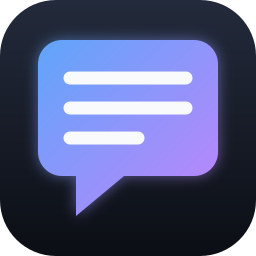
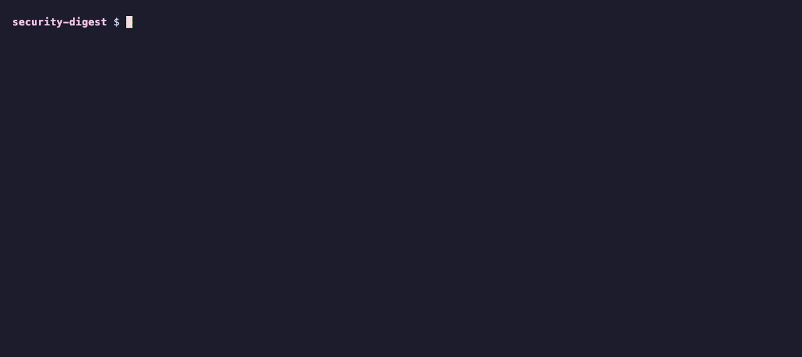

<div align="center">



# security-digest

**Few people open the AWS Security Hub console every day. security-digest posts what matters to Slack instead.**

[](src/security_digest)
[](versions.tf)
[](cloudformation/security-digest.yaml)
[](tests)
[](LICENSE)

<br>



<sub>The real formatting code, run on sample findings with <code>make preview</code>. No AWS account needed.</sub>

</div>

## ✨ What it does

- **Groups findings.** A problem on 40 instances is one row with a count and the accounts it affects, not 40 lines.
- **Counts findings per account**, so you can see where the problems are.
- **Shows patch health:** missing patches and failed patch runs.
- **Calls out new CVEs** from the last 24 hours, not the whole backlog.
- **Alerts in real time, if you want it,** for each new CRITICAL finding.
- **Doesn't fail silently.** If Slack rejects a message, the reason is logged and the function errors.

Part of [aws-security-toolkit](https://github.com/simar-s2/aws-security-toolkit), and works on its own.

<a name="run-it"></a>
## ⚡️ Run it

See a sample digest in your terminal, with no AWS account:

```bash
git clone https://github.com/simar-s2/security-digest && cd security-digest
make preview
```

To deploy it, create a Slack [incoming webhook](https://api.slack.com/messaging/webhooks). Then, in the security account and the Security Hub home region:

```bash
aws ssm put-parameter --name /security-digest/slack-webhook --type SecureString \
  --value "https://hooks.slack.com/services/..."
scripts/deploy.sh --profile security --region us-east-1 \
  --webhook-param /security-digest/slack-webhook
aws lambda invoke --function-name sec-security-digest /dev/stdout    # send one now
```

Terraform and every option: [docs/SETUP.md](docs/SETUP.md).

## 🔬 How it works

A schedule runs a Lambda function on weekdays at 14:00 UTC, which you can change. It reads the findings Security Hub has collected from across the organization, groups them and posts one message to Slack. The webhook URL stays in an encrypted SSM parameter, so it never appears in Terraform state or CloudFormation parameters.

The architecture diagram and the choices I made: [docs/DESIGN.md](docs/DESIGN.md).

## 💰 Cost

Effectively free for most organizations. The function runs for a few seconds a day, inside the Lambda free tier, and EventBridge Scheduler's free tier covers the schedule. Security Hub itself is [billed separately](https://github.com/simar-s2/org-security-baseline#cost).

## 💡 Things I learned

- **The finding that says patching is broken is easy to miss.** A failed patch run is LOW severity, so a CRITICAL and HIGH view never shows it. The digest gives patch health its own section, counted per account.
- **Security Hub re-imports a finding every time it's updated.** Without a check, old findings would alert again, so real-time alerts ignore anything created more than 24 hours earlier.
- **CVEs can drown out everything else.** Tens of thousands of container CVE findings would bury the rest, so they get their own section, limited to what's new.

## 🛠️ Development

```bash
make test       # pytest and terraform test; nothing calls AWS
make lint       # terraform fmt/validate, tflint, cfn-lint, checkov, shellcheck, ruff
make preview    # render the sample digest in the terminal
```

## 📄 License

[MIT](LICENSE)
